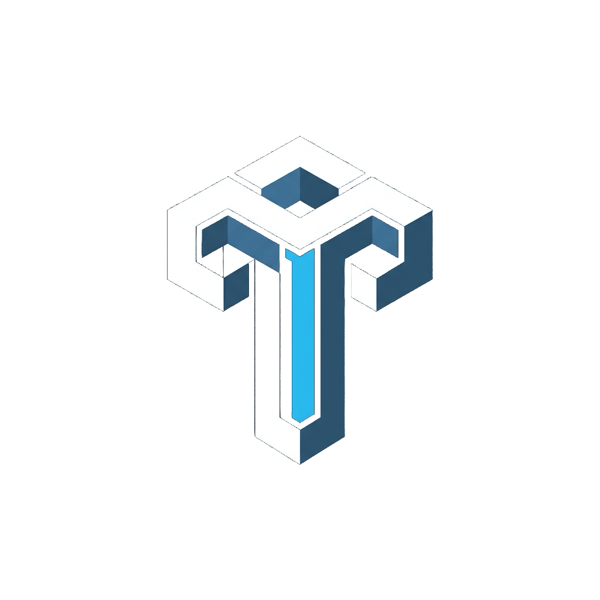
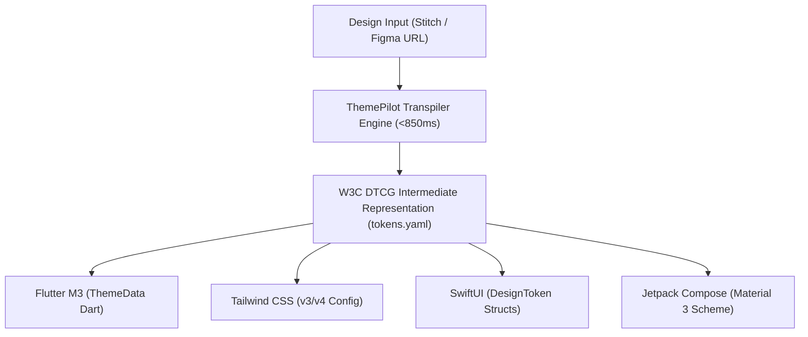
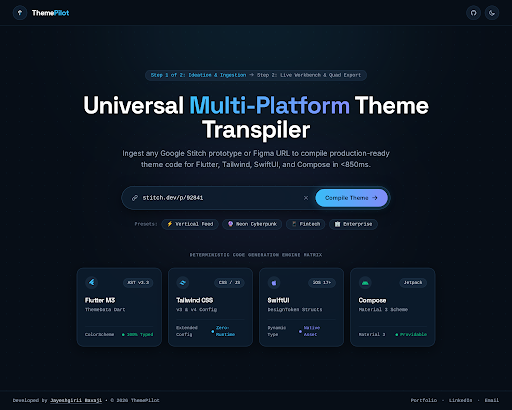
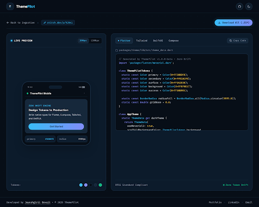
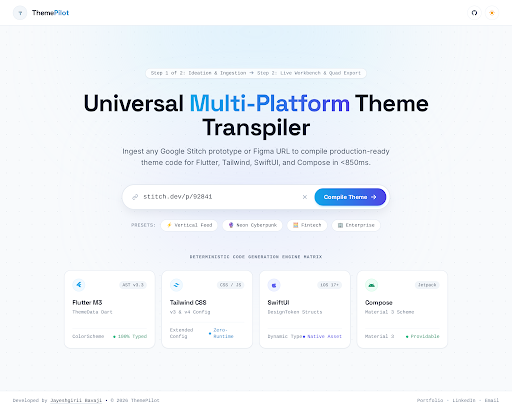
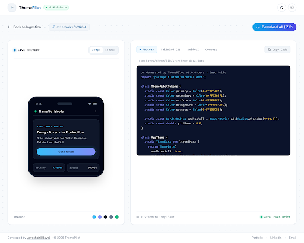

<p align="center">
  
</p>

<h1 align="center">ThemePilot</h1>

<p align="center">
  <strong>Universal Multi-Platform Theme Transpiler</strong><br>
  <em>Ingest any Google Stitch prototype or Figma URL to compile production-ready theme code for Flutter, Tailwind, SwiftUI, and Compose in &lt;850ms.</em>
</p>

<p align="center">
  <a href="https://flutter.dev"></a>
  <a href="https://tailwindcss.com"></a>
  <a href="https://developer.apple.com/xcode/swiftui/"></a>
  <a href="https://developer.android.com/jetpack/compose"></a>
  <a href="https://design-tokens.github.io/community-group/format/"></a>
  <a href="LICENSE"></a>
</p>

---

## 📑 Table of Contents

- [The Problem](#-the-problem-the-100000-token-desynchronization-tax)
- [How ThemePilot Works](#-how-themepilot-works)
- [The 2-Step Architecture](#-the-2-step-architecture)
- [Screenshots & Visual Design](#-screenshots--visual-design)
  - [Dark Theme](#-dark-theme-scaffold-obsidian-navy-070e17)
  - [Light Theme](#-light-theme-crisp-alabaster-f8fafc)
- [Multi-Platform Code Outputs](#-multi-platform-code-outputs)
  - [1. Flutter (Material 3)](#1-flutter-material-3-themedata)
  - [2. Tailwind CSS (v3 & v4)](#2-tailwind-css-v3--v4-config)
  - [3. Apple SwiftUI (iOS 17+)](#3-apple-swiftui-ios-17)
  - [4. Android Jetpack Compose](#4-android-jetpack-compose-material-3)
- [CLI Tools & Validation Gates](#-cli-tools--validation-gates)
- [Flutter Web Application](#-flutter-web-application)
- [Google Stitch Design System](#-google-stitch-design-system)
- [Author & Attribution](#-author--attribution)
- [License](#-license)

---

## ⚡ The Problem: The $100,000 Token Desynchronization Tax

Every product organization supporting multiple client platforms (Flutter mobile, React web, SwiftUI iOS, and Jetpack Compose Android) pays an invisible recurring tax: **Design Token Desynchronization**.

```
Figma / Stitch URL ──> Web Team  ──> tailwind.config.js (Manual Copy-Paste)
                    ──> Flutter   ──> ThemeData.dart     (Manual Translation)
                    ──> iOS Team  ──> Color Structs      (Manual Edits)
                    ──> Android   ──> ColorScheme.kt     (Manual Sync)
```

By sprint three, the platforms inevitably drift:
- Spacing diverges by $2\text{dp}$ to $4\text{dp}$.
- Colors drift by subtle hex values (`#38BDF8` vs `#3BB0E6`).
- Border radiuses lose cohesion between web pills and native shapes.

**ThemePilot** eliminates this chasm by treating the design system as a **deterministic, single-source-of-truth compiler**. In under $850\text{ms}$, it ingests any Google Stitch or Figma URL, normalizes design tokens into a W3C DTCG-compliant intermediate representation, and compiles four native production codebases simultaneously with zero manual translation.

---

## 🔬 How ThemePilot Works



1. **Ingestion & Extraction:** Reads raw design tokens directly via API / MCP metadata (palette roles, typographic scale, 8dp spatial rhythm, and component elevation).
2. **Intermediate Representation (IR):** Validates and normalizes tokens against the W3C Design Token Community Group (DTCG) specification.
3. **Multi-Platform AST Compilation:** Generates typed, idiomatic codebases tailored for each target platform with zero runtime reflection.
4. **Zero Drift Verification:** Automated AST validation gates ensure zero hardcoded color definitions or arbitrary spacing values exist outside the compiled tokens.

---

## 🚀 The 2-Step Architecture

ThemePilot enforces radical simplicity: **Zero cockpit clutter, zero duplicate actions, and complete flow clarity.**

### Step 1: Ideation & Ingestion
- **Omni-Input Bar:** Ingests any Google Stitch prototype or Figma URL (`stitch.dev/p/92841`).
- **Quick-Start Presets:** One-click ingestion presets for *⚡ Vertical Feed*, *🔮 Neon Cyberpunk*, *📱 Fintech*, and *🏢 Enterprise*.
- **Deterministic Engine Matrix:** Visualizes compilation targets with runtime tags, AST version badges, and type-safety indicators.

### Step 2: Implementation & Live Workbench
- **Single Source of Truth Top Bar:** Quick `← Back to Ingestion` navigation with exactly **one** primary `Download All (.ZIP)` button.
- **Dual-Pane Layout:**
  - **Left Pane (Live Component Canvas):** Responsive `390px` mobile chassis simulator and `1200px` desktop toggle running live tokenized components (status bar, dynamic card, gradient stadium CTA, and a 5-swatch palette).
  - **Right Pane (Tabbed Code Inspector):** Tabbed code output for Flutter, Tailwind, SwiftUI, and Compose with a single `Copy Code` action, exact filepath display, and DTCG zero-drift status.

---

## 📸 Screenshots & Visual Design

### 🌙 Dark Theme (Scaffold Obsidian Navy `#070E17`)

| Step 1: Ideation & Ingestion | Step 2: Live Workbench |
| :---: | :---: |
|  |  |

---

### ☀️ Light Theme (Crisp Alabaster `#F8FAFC`)

| Step 1: Ideation & Ingestion | Step 2: Live Workbench |
| :---: | :---: |
|  |  |

---

## 📦 Multi-Platform Code Outputs

ThemePilot deterministically emits native code for all 4 ecosystems:

### 1. Flutter (Material 3 ThemeData)
```dart
// Generated by ThemePilot • packages/theme/lib/src/theme_data.dart
import 'package:flutter/material.dart';

class ThemePilotTokens {
  static const Color primary = Color(0xFF38BDF8);
  static const Color secondary = Color(0xFF818CF8);
  static const Color surface = Color(0xFF16283B);
  static const Color background = Color(0xFF070E17);
  static const Color success = Color(0xFF10B981);
  static const BorderRadius radiusFull = BorderRadius.all(Radius.circular(9999.0));
  static const double gridBase = 8.0;
}

class AppTheme {
  static ThemeData get darkTheme => ThemeData(
    useMaterial3: true,
    scaffoldBackgroundColor: ThemePilotTokens.background,
    colorScheme: const ColorScheme.dark(
      primary: ThemePilotTokens.primary,
      secondary: ThemePilotTokens.secondary,
      surface: ThemePilotTokens.surface,
    ),
  );
}
```

### 2. Tailwind CSS (v3 & v4 Config)
```javascript
// Generated by ThemePilot • tailwind.config.js
module.exports = {
  darkMode: 'class',
  theme: {
    extend: {
      colors: {
        scaffold: '#070E17',
        midnight: '#0D1D2E',
        surface: '#16283B',
        accent: {
          aero: '#38BDF8',
          violet: '#818CF8',
          emerald: '#10B981',
        },
      },
      borderRadius: {
        pill: '9999px',
      },
    },
  },
};
```

### 3. Apple SwiftUI (iOS 17+)
```swift
// Generated by ThemePilot • Sources/Theme/ThemePilotTokens.swift
import SwiftUI

public enum ThemePilotTokens {
    public static let primary = Color(red: 0.22, green: 0.74, blue: 0.97)
    public static let secondary = Color(red: 0.51, green: 0.55, blue: 0.97)
    public static let surface = Color(red: 0.09, green: 0.16, blue: 0.23)
    public static let scaffold = Color(red: 0.03, green: 0.05, blue: 0.09)
    public static let cornerRadiusPill: CGFloat = 9999.0
}
```

### 4. Android Jetpack Compose (Material 3)
```kotlin
// Generated by ThemePilot • com/themepilot/theme/Theme.kt
package com.themepilot.theme

import androidx.compose.material3.darkColorScheme
import androidx.compose.ui.graphics.Color

val ThemePilotDarkColorScheme = darkColorScheme(
    primary = Color(0xFF38BDF8),
    secondary = Color(0xFF818CF8),
    surface = Color(0xFF16283B),
    background = Color(0xFF070E17),
)
```

---

## 🛠️ CLI Tools & Validation Gates

The [`tools/`](tools/) directory houses validation scripts and token compilers:

| Script | Purpose | Command |
| :--- | :--- | :--- |
| **`compile_tokens.dart`** | Ingests `tokens.yaml` and compiles production Flutter Material 3 classes into `lib/src/core/theme/`. | `dart run tools/compile_tokens.dart` |
| **`audit_tokens.dart`** | AST scanner enforcing zero hardcoded color values (`Color(0x...)`) or non-grid padding values. | `dart run tools/audit_tokens.dart` |
| **`validate_specs.dart`** | Validates Design System as Code (DSaC) specifications against the 8-section architectural contract. | `dart run tools/validate_specs.dart` |

---

## 🌐 Flutter Web Application

ThemePilot is built as a high-performance **Flutter / Dart Web application** utilizing Flutter 3.x with CanvasKit and WebAssembly (WASM) compilation for responsive desktop and tablet browser runtimes.

### Prerequisites

- [Flutter SDK](https://docs.flutter.dev/get-started/install) (`^3.19.0` or higher)
- Google Chrome, Brave, or any modern Chromium browser

### Running Locally

```bash
# 1. Clone the repository
git clone https://github.com/jbavaji/ThemePilot.git
cd ThemePilot

# 2. Fetch dependencies
flutter pub get

# 3. Launch Flutter Web in Chrome (Debug mode)
flutter run -d chrome

# 4. Or launch with specific port and CanvasKit renderer
flutter run -d chrome --web-renderer canvaskit --web-port 3000
```

### Production Web Build

```bash
# Build optimized production web release
flutter build web --release --web-renderer canvaskit

# Preview the production build locally
cd build/web && python3 -m http.server 8080
```

### Key Application Capabilities

- **Interactive Ingestion:** Ingest any Stitch prototype or Figma URL, or pick from pre-configured preset chips (*Vertical Feed, Neon Cyberpunk, Fintech, Enterprise*).
- **Sub-850ms Transpiler:** Real-time token parsing, DTCG validation, and AST code emission.
- **Live Responsive Canvas:** Live interactive mobile chassis simulator with responsive viewport toggling (`390px` mobile / `1200px` desktop).
- **Multi-Platform Code Inspector:** Tabbed syntax inspection across **Flutter**, **Tailwind**, **SwiftUI**, and **Compose**.
- **Zero-Drift Token Palette:** Live DTCG color swatches and radius tokens.
- **Theme Mode Reactive Toggle:** Seamless switching between Dark Mode and Light Mode.
- **1-Click Quad Export:** Bundles all 4 production-ready theme codebases into a single `.ZIP` download.

---

## 🎨 Google Stitch Design System

ThemePilot is designed and managed using the Google Stitch design system:

- **Project ID:** `6483655198524984692`
- **Design System Asset:** `assets/f5233746157a4c34bb24ba8dca50f8fc` (governed by [`DESIGN.md`](DESIGN.md))
- **Synchronized Screens:**
  - `896c35294d8f48f3b7e3af2978627118` — Step 1: Ideation & Ingestion (Dark Theme)
  - `6e377db221aa4764ad7c202047278a9b` — Step 1: Ideation & Ingestion (Light Theme)
  - `7f4b2c2c0fcd4ab080048f4c908c846a` — Step 2: Implementation & Live Workbench (Dark Theme)
  - `0e32d66ef92b4cf28439ff0d9b78c7b6` — Step 2: Implementation & Live Workbench (Light Theme)

---

## 👨‍💻 Author & Attribution

Developed with precision by **[Jayeshgiri Bavaji](https://jbavaji.github.io/)**

- **Portfolio:** [https://jbavaji.github.io/](https://jbavaji.github.io/)
- **LinkedIn:** [https://www.linkedin.com/in/jbavaji/](https://www.linkedin.com/in/jbavaji/)
- **Email:** [jbavaji@gmail.com](mailto:jbavaji@gmail.com)

---

## 📄 License

This project is open-source software licensed under the [MIT License](LICENSE).
