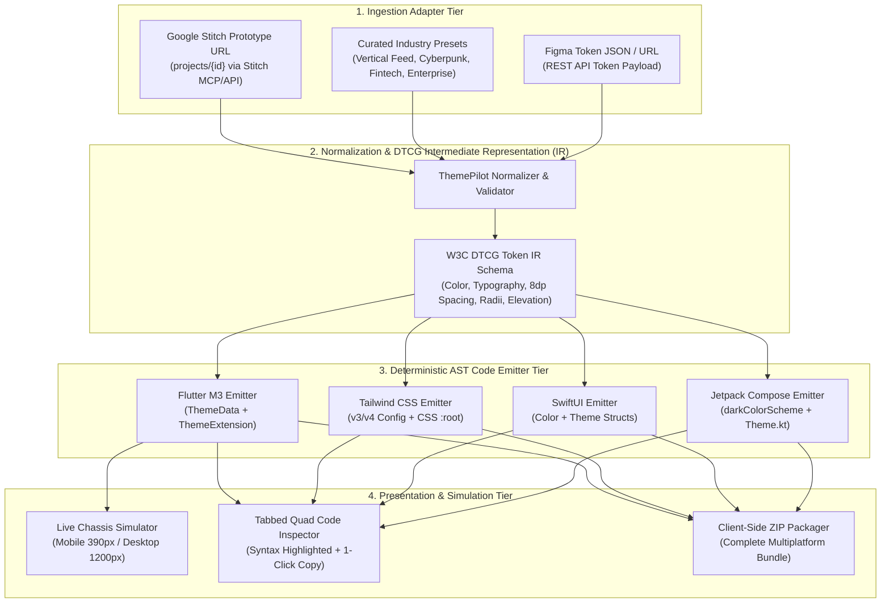

# Architecture Requirements Document (ARD)
## ThemePilot: Multi-Platform Theme Transpiler Engine

| Document Metadata | Value |
| :--- | :--- |
| **Document Version** | `1.0.0` |
| **Status** | `Draft for Review` |
| **Product Name** | ThemePilot |
| **Primary Architectural Pattern** | Compiler Pipeline / Intermediate Representation (IR) Pattern |
| **Author** | Senior Software & AI-SDLC Architect |
| **Governing BRD** | [`docs/brd/BRD_THEMEPILOT_V1.md`](../brd/BRD_THEMEPILOT_V1.md) |
| **Last Updated** | October 2026 |

---

## 1. Architectural Philosophy & Core Tenets

ThemePilot's architecture is guided by three non-negotiable principles:

1. **Design System as a Compiler (Not Static Art):**
   A design system is not a static Figma frame or a 40-page PDF style guide. It is a **deterministic compiler** that translates design intent into strongly typed code across all supported targets.
2. **Intermediate Representation (IR) Normalization:**
   No source design tool directly emits platform code. All inputs are normalized into a **W3C Design Token Community Group (DTCG)** compliant Intermediate Representation (`tokens.yaml` / JSON IR). This decouples design sources from target platforms ($M \times N$ problem reduced to $M + N$).
3. **Deterministic AST Emission with Zero Reflection:**
   Emitted code contains no reflection, dynamic eval, or proprietary SDK dependencies. It outputs native, readable, idiomatic code tailored for each framework's standard tooling.

---

## 2. End-to-End System Architecture

The ThemePilot system comprises four decoupled architectural tiers:



---

## 3. Detailed Tier Specifications

### 3.1 Tier 1: Ingestion Adapter Tier
Responsible for parsing incoming URLs, extracting design metadata, and shielding the core compiler from upstream API variations.

* **Stitch Adapter:** Uses the project identifier (`projects/{id}`) to fetch design tokens, color styles, and component metadata via Stitch MCP or exported metadata.
* **Preset Registry:** In-memory, validated DTCG token bundles for offline use and zero-latency onboarding (*Vertical Feed*, *Neon Cyberpunk*, *Fintech*, *Enterprise*).
* **Figma Adapter:** Parses standard Figma design token JSON exports.

### 3.2 Tier 2: Normalization & W3C DTCG Token IR
The internal representation adheres to the [W3C Design Tokens Community Group Specification](https://design-tokens.github.io/community-group/format/):

```yaml
# Conceptual W3C DTCG Intermediate Representation (IR)
color:
  background:
    scaffold:
      $value: "#070E17"
      $type: "color"
  surface:
    default:
      $value: "#16283B"
      $type: "color"
    dim:
      $value: "#0D1D2E"
      $type: "color"
    high:
      $value: "#1E354D"
      $type: "color"
  accent:
    primary:
      $value: "#38BDF8"
      $type: "color"
    secondary:
      $value: "#818CF8"
      $type: "color"
    success:
      $value: "#10B981"
      $type: "color"

spacing:
  baseGrid:
    $value: 8
    $type: "dimension"
  xxs:
    $value: 2
    $type: "dimension"
  xs:
    $value: 4
    $type: "dimension"
  sm:
    $value: 8
    $type: "dimension"
  md:
    $value: 16
    $type: "dimension"
  lg:
    $value: 24
    $type: "dimension"
  xl:
    $value: 32
    $type: "dimension"

borderRadius:
  sharp:
    $value: "0px"
    $type: "dimension"
  subtle:
    $value: "12px"
    $type: "dimension"
  prominent:
    $value: "16px"
    $type: "dimension"
  pill:
    $value: "9999px"
    $type: "dimension"
```

### 3.3 Tier 3: Multi-Platform AST Code Emitter Tier
Each platform emitter is a pure, side-effect-free compiler function:
$$\text{Emitter}: \text{TokenIR} \longrightarrow \text{PlatformCodeString}$$

1. **Flutter Emitter (`FlutterM3Emitter`):**
   - Emits `ThemePilotTokens` (constants for colors, radiuses, and grid spacing).
   - Emits `ThemeData` configuring `ColorScheme.dark()`, `scaffoldBackgroundColor`, and typography styles.
   - Emits custom `ThemeExtension<T>` for tokens outside base Material 3 spec.
2. **Tailwind CSS Emitter (`TailwindEmitter`):**
   - Emits `tailwind.config.js` with `theme.extend.colors`, `theme.extend.borderRadius`, and spacing.
   - Emits CSS Custom Properties (`:root { --tp-primary: #38BDF8; ... }`).
3. **SwiftUI Emitter (`SwiftUIEmitter`):**
   - Emits `ThemePilotTokens.swift` with RGB-normalized static `Color` declarations.
   - Emits semantic ViewModifier and corner radius constants.
4. **Jetpack Compose Emitter (`ComposeM3Emitter`):**
   - Emits `com.themepilot.theme.Theme.kt` with `darkColorScheme()` and `MaterialTheme` wrapper.
   - Emits type-safe `Color(0xFF...)` constants and standard CompositionLocals.

### 3.4 Tier 4: Presentation & Simulation Tier
Built in Flutter Web (CanvasKit/WASM) for 60fps rendering:
* **Chassis Simulator:** Renders real tokenized Flutter widgets inside a fixed-width container:
  - *Mobile Mode:* Fixed 390px $\times$ 844px chassis simulating an iPhone 15 / modern Android viewport.
  - *Desktop Mode:* 1200px responsive preview simulating an administrative dashboard card.
* **Code Inspector:** Tabbed, syntax-highlighted code viewer displaying exact file paths and line counts.
* **Client-Side Packager:** Packages all 4 generated files into a `.ZIP` archive instantly in the browser without server communication.

---

## 4. Non-Functional Requirements (NFRs) & Architectural Constraints

| Constraint | Requirement | Architectural Enforcement |
| :--- | :--- | :--- |
| **Latency SLO** | Transpile $< 850\text{ms}$ | Synchronous in-memory AST generation; zero network calls during compilation once tokens are ingested. |
| **Zero Runtime Reflection** | No `dart:mirrors`, no runtime `eval()` | Pure deterministic static string/AST emission. |
| **Offline Independence** | 100% operational offline | Bundled preset fallback and local in-memory IR parsing. |
| **Multi-Platform Parity** | 0.00% color/spacing drift | All emitters derive from the same single `TokenIR` instance. |
| **Zero-Drift CI Enforcement** | Prevent unauthorized styles | Abstract Syntax Tree scanner (`tools/audit_tokens.dart`) integrated into build gates. |

---

## 5. Architectural Decision Records (ADRs) Summary

The following ADRs govern this architecture:
1. **[`ADR-001`](adr/001_w3c_dtcg_ir.md):** Adoption of W3C Design Tokens Community Group (DTCG) as the Intermediate Representation format.
2. **[`ADR-002`](adr/002_deterministic_ast_generation.md):** Pure deterministic AST generation over string templates or reflection.

---

## 6. Document Sign-Off & Next Steps

This ARD establishes the technical foundation for ThemePilot. Upon review, functional user experience and workflow contracts will be established in **Step 1.3: Product Requirements Document (PRD)**.
